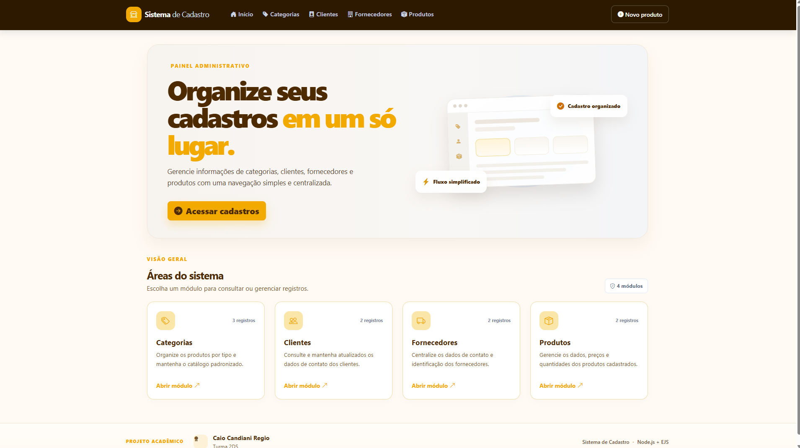

# Sistema de Cadastro — CRUD Node.js

Aplicação web acadêmica para cadastrar, consultar, editar e excluir categorias, clientes, fornecedores e produtos. O projeto utiliza Node.js, Express, EJS e Bootstrap para oferecer um painel administrativo responsivo com operações CRUD completas.

## Integrantes

- Caio Candiani Regio
- Turma: 2DS

## Objetivo

Praticar desenvolvimento web com renderização de páginas EJS, rotas Express, operações CRUD, validação de formulários, organização de componentes reutilizáveis e publicação de uma aplicação web.

## Visão geral

Este projeto centraliza e organiza os cadastros de categorias, clientes, fornecedores e produtos em uma única interface administrativa.



## Tecnologias utilizadas

- **Node.js** — ambiente de execução JavaScript.
- **Express 4** — servidor HTTP, middleware e rotas.
- **EJS 3** — renderização de templates no servidor.
- **Bootstrap 5.3** — componentes e grid responsivo.
- **Bootstrap Icons** — ícones da interface.
- **CSS e JavaScript** — identidade visual, interações e confirmação de exclusão.
- **JSON local** — armazenamento de desenvolvimento quando as variáveis do Supabase não estão configuradas.
- **Supabase REST API** — opção de persistência no deploy.
- **Node.js Test Runner** — testes automatizados com `node:test`.

## Funcionalidades

O sistema oferece operações completas de criação, leitura, atualização e exclusão para as quatro entidades principais.

| Entidade | Dados principais | Operações |
|---|---|---|
| Categorias | Nome | Criar, listar, editar e excluir |
| Clientes | Nome, e-mail, telefone e cidade | Criar, listar, editar e excluir |
| Fornecedores | Razão social, CNPJ, e-mail, telefone e endereço | Criar, listar, editar e excluir |
| Produtos | Nome, descrição, preço, estoque e categoria | Criar, listar, editar e excluir |

Além disso, o sistema inclui:

- pesquisa por texto nas listagens;
- validação de campos obrigatórios;
- mensagens de sucesso e erro;
- páginas de erro 404 e 500;
- confirmação antes da exclusão;
- layout responsivo para telas menores;
- indicadores de quantidade de registros na página inicial.

## Estrutura do projeto

```text
Nodejs--navega-o-EJS-main/
├── app.js
├── package.json
├── package-lock.json
├── .env.example
├── .gitignore
├── data/
│   └── store.js
├── docs/
│   ├── evidencias/
│   ├── prompt-utilizado.md
│   └── schema-supabase.sql
├── public/
│   ├── css/
│   │   └── app.css
│   └── js/
│       └── app.js
├── routes/
│   ├── categoriaRoutes.js
│   ├── clienteRoutes.js
│   ├── crudFactory.js
│   ├── entityConfig.js
│   ├── fornecedorRoutes.js
│   └── produtoRoutes.js
├── test/
│   └── app.test.js
├── views/
│   ├── entities/
│   ├── errors/
│   ├── partials/
│   └── index.ejs
└── README.md
```

## Uso da Inteligência Artificial

A IA foi utilizada como apoio para analisar a estrutura existente, identificar operações CRUD incompletas, propor uma organização mais reutilizável, sugerir melhorias de UX/UI e preparar a documentação do projeto. As alterações aplicadas ao código foram feitas de forma a preservar a funcionalidade original e modernizar a interface.

## Alterações sugeridas pela IA

- completar o CRUD de categorias e padronizar as operações das quatro entidades;
- centralizar listagem e formulário em templates reutilizáveis;
- melhorar a hierarquia visual e a responsividade;
- validar entradas e tratar erros de registros inexistentes;
- criar testes automatizados para as rotas principais;
- separar armazenamento local da persistência do deploy;
- atualizar a documentação e preparar evidências visuais.

## Alterações implementadas no código

- criação de `routes/crudFactory.js` e `routes/entityConfig.js` para padronizar rotas e campos;
- CRUD completo para categorias, clientes, fornecedores e produtos;
- templates compartilhados para listagem e formulários;
- redesign da página inicial, navegação, tabelas e páginas de erro;
- estilos responsivos em `public/css/app.css` e interações em `public/js/app.js`;
- armazenamento local em JSON para desenvolvimento e integração opcional com Supabase;
- inclusão de `docs/schema-supabase.sql`, `.env.example` e testes em `test/app.test.js`;
- ajuste em `app.js` para exportar a aplicação corretamente e permitir execução local e deploy.

## Projeto e repositório

- **Autor:** Caio Candiani Regio
- **Repositório:** https://github.com/CaioRegio-eu/ATV-Final.git
- **GitHub do autor:** https://github.com/CaioRegio-eu

## Como executar localmente

Requer Node.js 20 ou superior.

```bash
npm install
npm run dev
```

Acesse `http://localhost:3005` no navegador.

Para iniciar sem Nodemon:

```bash
npm start
```

Na primeira execução sem a configuração do Supabase, o projeto cria `data/cadastros.json` com registros de demonstração. Esse arquivo é ignorado pelo Git. Também é possível definir outro caminho por meio da variável `DATA_FILE`.

Para rodar os testes automatizados:

```bash
npm test
```

## Persistência e configuração da Vercel

O modo JSON é adequado para desenvolvimento local, mas não garante persistência em ambiente serverless. Sem banco externo, a aplicação na Vercel pode usar um arquivo em `/tmp`, que pode ser descartado em novas instâncias ou reinicializações.

Para habilitar persistência com Supabase:

1. Crie um projeto no Supabase.
2. Abra o SQL Editor e execute o arquivo [`docs/schema-supabase.sql`](docs/schema-supabase.sql).
3. Em **Project Settings → API**, copie a URL do projeto e a chave `service_role`.
4. No painel da Vercel, configure as variáveis `SUPABASE_URL` e `SUPABASE_SERVICE_ROLE_KEY` em **Settings → Environment Variables**.
5. Faça um novo deploy e teste cada operação CRUD na URL publicada.

Para desenvolvimento local com banco persistente, crie um arquivo `.env` a partir de [`.env.example`](.env.example) e preencha as variáveis. O Node.js não lê `.env` automaticamente; portanto, é necessário exportar as variáveis antes de iniciar o projeto ou usar uma ferramenta específica para isso.

A aplicação não possui autenticação nem controle de acesso. Em um deployment público, qualquer pessoa que acesse as rotas pode tentar cadastrar, editar e excluir dados. Por isso, em produção, use apenas dados de demonstração ou implemente autenticação/autorização antes de armazenar informações reais.

## Arquivos de referência

- Prompt completo: [`docs/prompt-utilizado.md`](docs/prompt-utilizado.md)
- SQL para Supabase: [`docs/schema-supabase.sql`](docs/schema-supabase.sql)
- Variáveis de ambiente de exemplo: [`.env.example`](.env.example)
- Testes automatizados: [`test/app.test.js`](test/app.test.js)
- Pasta de evidências: [`docs/evidencias/`](docs/evidencias/)

## Evidências do projeto

A pasta de evidências contém imagens e registros visuais do sistema, incluindo a tela inicial antes da reestilização:

- [docs/evidencias/antes-pagina-inicial.png](docs/evidencias/antes-pagina-inicial.png)

## Prompt utilizado

O prompt completo que orientou a implementação está disponível em [`docs/prompt-utilizado.md`](docs/prompt-utilizado.md).

## Observações finais

Este projeto foi desenvolvido como atividade acadêmica e tem foco em praticar desenvolvimento web com Node.js, Express, EJS e Bootstrap. A estrutura atual foi organizada para facilitar manutenção, reutilização de componentes e expansão futura do sistema.

